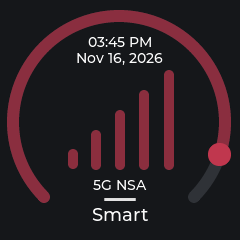
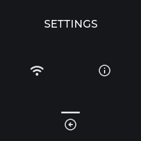
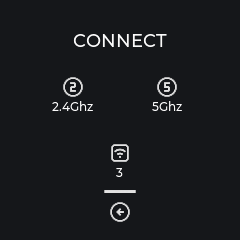
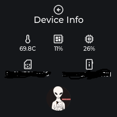

# the101 custom UI

The Globe the101 modem features a circular display with touch support. As a curious individual, I wanted to find a way to modify its default UI. It took me a while to discover that the UI uses LVGL. Once I found out, I immediately set up a development environment with the latest version of LVGL and ran a simple display on the device, which worked. Next, I added the UI, but it kept getting stuck because of a known bug. After patching the bug and recompiling, it worked. That brings us to this journey.

| Screen        | Image                           |
| ------------- | ------------------------------- |
| Main          |            |
| Settings      |    |
| Scan Wi-Fi QR |      |
| Device Info   |  |

## Setting up

In order to compile lvgl we need the `toolchain-aarch64_generic_gcc-7.5.0_musl` which can be found on `openwrt-sdk-19.07.10-armvirt-64_gcc-7.5.0_musl.Linux-x86_64` SDK and LVGL 9x, after setting up we should export the path if you cloned this repository and is inside the `rain101-ui` you need to run:

```bash
export SDK=../openwrt-sdk-19.07.10-armvirt-64_gcc-7.5.0_musl.Linux-x86_64
export STAGING_DIR=$(cd "$SDK" && pwd)/staging_dir
export PATH=$STAGING_DIR/toolchain-aarch64_generic_gcc-7.5.0_musl/bin:$PATH
```

Once you have the toolchain setup next thing is to create/compile the ui I used **EEZ Studio** to arrange the UI you can use any software you can as long as you can export it as LVGL

After doing the modification it's now time to compile:

```bash
aarch64-openwrt-linux-musl-gcc   -O2 -flto -fomit-frame-pointer -pipe -static -s   -o routerui   $(find . -maxdepth 1 -name '*.c')   -I. -I./ui -I.. -I../lvgl   -DLV_CONF_INCLUDE_SIMPLE   $(find ../lvgl/src -name '*.c')   $(find ./ui -name '*.c')   -ffunction-sections -fdata-sections   -Wl,--gc-sections   -lm -lpthread
```

After it's done we need to sftp the compiled binary to the device for testing you need the openlined version with SSH enabled in order to do this first on a seperate terminal connect to the device and run `mkdir /tmp/test` once done run:

```bash
scp -o HostKeyAlgorithms=+ssh-rsa -o PubkeyAcceptedAlgorithms=+ssh-rsa     routerui root@192.168.0.1:/tmp/test
```

You'd be prompted with your password just enter it and execute `killall routerui` if your using the stock globe firmware `killall littlelvgl` and run `./routerui` check if the ui changed if everthing is okay move the binary `mv routerui /bin && chmod +x /bin/routerui` All done!.

Backend Used:

| Backend                               | What it does                               |
| ------------------------------------- | ------------------------------------------ |
| ubus -S call mtk.cell get_device_info | returns a cellular modem diagnostic report |
